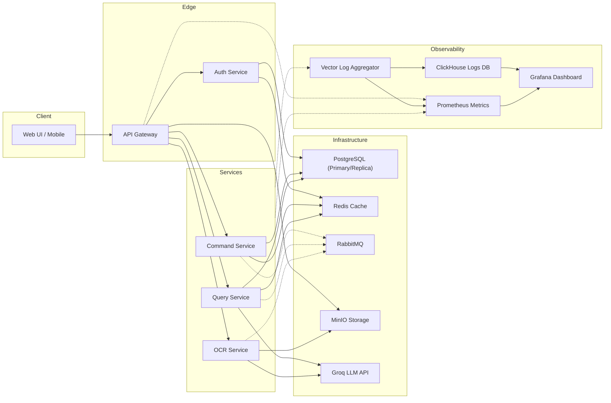

# Personal Finance Assistant

[](https://openjdk.org/)
[](https://developer.mozilla.org/en-US/docs/Web/JavaScript)
[](https://developer.mozilla.org/en-US/docs/Web/HTML)
[](https://spring.io/projects/spring-boot)
[](https://www.docker.com/)
[](https://www.postgresql.org/)
[](https://redis.io/)
[](https://www.rabbitmq.com/)
[](https://minio.io/)
[](https://groq.com/)
[](https://clickhouse.com/)
[](https://vector.dev/)
[](https://grafana.com/)

A comprehensive, production-ready personal finance platform built on a microservices architecture. This application enables users to track income and expenses, manage split bills, define savings goals, automatically extract structured data from scanned receipts, and receive AI-generated financial insights. 

All services communicate securely via a JWT-secured API Gateway, utilizing Redis for high-performance caching and RabbitMQ for asynchronous event propagation. The system is also equipped with an enterprise-grade observability pipeline powered by Vector, ClickHouse, and Grafana for centralized logging and telemetry.

---
## Architecture Overview



---
## Key Features

- **Income & Expense Tracking**: Fully-featured ledger to record, categorize, and query day-to-day financial transactions.
- **Automated Subscription Detection**: A scheduled background job analyzes historical spending patterns to automatically detect recurring payments (e.g., Netflix, Gym), tracking active subscriptions and projecting upcoming charge dates.
- **Savings Goals**: Users can define target amounts and deadlines for specific goals (e.g., "Vacation Fund"). The platform tracks progress and calculates required monthly contributions.
- **Category Budgets**: Set hard spending limits across different categories (e.g., "Food", "Entertainment"). Real-time analytics track your burn rate to prevent overspending.
- **Group Split Bills**: Seamlessly share expenses among friends or roommates. The system automatically calculates complex debt relationships to determine exactly who owes whom.
- **AI-Powered Financial Insights**: Aggregates your transaction history and feeds it securely into the Groq LLM API to generate personalized financial health scores and actionable insights.
- **OCR Receipt Parsing**: Upload an image of a receipt, and the backend uses PaddleOCR to instantly extract the merchant, total amount, and date for one-click ingestion.

---
## System Architecture & Data Flow

This platform is engineered as a highly scalable, event-driven microservices ecosystem following CQRS (Command Query Responsibility Segregation) patterns.

### 1. Client Application (Frontend)
The user interface is engineered as a lightning-fast Single Page Application (SPA).
- **Zero-Dependency Core**: Built purely with Vanilla JavaScript (ES6 Modules) and native HTML5/CSS3 to guarantee near-instant load times.
- **Server-Sent Events (SSE)**: Establishes a real-time, persistent connection with the backend to receive instant UI updates (e.g., when a background AI batch job finishes).

### 2. Edge: API Gateway + Auth Service
All incoming client traffic passes through the **Spring Cloud Gateway**, which
does *only* proxy work; credentials are handled by a separate service.
- **Centralized Routing & CORS**: Routes `/api/auth/**` to Auth, `/api/upsert/**`
  to Command, `/api/analytics/**` to Query, `/api/storage/**` to MinIO.
- **Security Validation**: Validates JWT signatures (including the Redis
  blacklist), then strips any client-supplied `X-User-Id` and injects the value
  from the signed token.
- **MinIO Integration**: Streams uploads (bank statements, receipts, avatars) to
  **MinIO**, off the Netty event loop, then dispatches the async OCR job.
- **Auth Service**: Owns the `auth.users` schema — registration, login,
  refresh-token rotation, logout/blacklisting and profile updates. It runs
  BCrypt on a worker pool, never on an event loop.

### 3. Core Business Services (CQRS Pattern)
- **Auth Service**: See §2 — a reactive service of its own (`auth-service:8082`)
  with its own database schema and the same JWT secret as the gateway.
- **Command Service**: The primary operational engine. It executes all core mutations (CRUD operations) for transactions, budgets, goals, and shared group bills. It persists canonical state directly to its isolated schema in **PostgreSQL**.
- **Query Service**: Optimized for ultra-fast reads, aggregations, and dashboard analytics. It maintains a highly optimized cache layer in **Redis** and provides AI-powered financial insights using the **Groq LLM**.
- **OCR Service**: A Python/FastAPI ML worker. It leverages **PaddleOCR** and **Groq** to perform Optical Character Recognition and semantic parsing on receipt images and batch bank statements. 

### 4. Event-Driven Architecture (Asynchronous Flow)
To ensure high performance and loose coupling, the system leverages **RabbitMQ** and **Redis** for state propagation.
- **Cache Invalidation & Outbox**: When the Command Service modifies data, it publishes a `transaction-cache-evict` event to RabbitMQ. The Query Service consumes this and instantly invalidates stale pre-computed aggregations in Redis.
- **Batch AI Processing**: When a user uploads a multi-page Bank Statement PDF, the API Gateway drops the file in MinIO and sends an `ocr.job` event to RabbitMQ. The OCR Service consumes the job, processes it using Groq, and posts the results back to an internal webhook. The Command Service then broadcasts this via SSE so the user's UI updates in real-time.

### 5. Telemetry & Observability Pipeline
A robust, enterprise-grade observability stack monitors the entire cluster.
- **Log Aggregation (Vector & ClickHouse)**: Every microservice outputs structured JSON logs. **Vector** acts as an ultra-fast, lightweight log aggregator that scrapes the Docker socket, sanitizes the payloads (redacting PII like emails and passwords), and ships the logs in bulk to **ClickHouse**—a columnar database optimized for massive analytical queries.
- **Metrics Scraping (Prometheus)**: Each Spring Boot microservice exposes a `/actuator/prometheus` endpoint. **Prometheus** periodically scrapes these endpoints to collect JVM metrics, HTTP latencies, and connection pool statuses. It also scrapes kubelet's **cAdvisor** endpoint (`/metrics/cadvisor`), which is where per-pod CPU, memory and restart metrics come from. Additionally, Vector computes real-time error rates from the log streams and exposes them as native Prometheus metrics.
- **Visualization (Grafana)**: **Grafana** serves as the single pane of glass. It is pre-configured with ClickHouse and Prometheus data sources and four dashboards: *Finance Assistant — Overview & Debug*, *Pods — CPU / memory / restarts*, *Redis — Debug & Runbook*, and *Postgres — Debug & Runbook*.

---

## Learn this system

| If you want to… | Read |
|---|---|
| Understand the concepts (gateway, JWT, CQRS, SSE, event flow) | this file, §Architecture |
| Look up **one service or pod**: what it does, its port, config, health check, logs, debug commands, common failures | [`k8s/SERVICES.md`](k8s/SERVICES.md) |
| Operate it day to day: deploy, access, debug, Grafana, data queries | [`k8s/RUNBOOK.md`](k8s/RUNBOOK.md) |
| Start/stop safely and prove no data was lost | [`k8s/START-STOP.md`](k8s/START-STOP.md) |
| Understand CI/CD and how a push becomes a running pod | [`k8s/README.md`](k8s/README.md) and [`k8s/ci/README.md`](k8s/ci/README.md) |

---
## Quick Start

### Prerequisites
- Docker and Docker Compose (v24 or newer)
- Java 21 (optional, required only for local compilation)
- Maven 3.9+ (optional, required only for local compilation)

### 1. Clone the Repository
```bash
git clone https://github.com/verginjose/Personal-Finance-Assistant.git
cd Personal-Finance-Assistant
```

### 2. Start the Infrastructure Stack
```bash
docker compose up -d
```
This command initializes PostgreSQL, Redis, RabbitMQ, MinIO, the six
microservices and the observability stack.

Services and their in-network ports (see `docker-compose.yml` and
[`k8s/SERVICES.md`](k8s/SERVICES.md#application-services)):

| Service | Port | Exposed locally |
|---|---|---|
| `frontend` (nginx) | 80 | http://localhost:3001 |
| `api-gateway` | 8080 | http://localhost:8080 |
| `auth-service` | 8082 | internal only (reached through the gateway) |
| `command-service` | 8081 | internal only |
| `query-service` | 8084 | internal only |
| `ocr-service` | 8100 | internal only |
| `grafana` | 3000 | http://localhost:3000 |
| `prometheus` | 9090 | http://localhost:9090 |
| `clickhouse` | 8123 | internal only |

### 3. Verify System Health
```bash
curl http://localhost:8080/actuator/health          # API Gateway
curl http://localhost:8080/api/auth/health          # Auth Service (through the gateway)
kubectl -n pfa get pods                             # k3s: all workloads
```

### 4. Execute the End-to-End Test Suite
```bash
python3 requests/run_e2e_tests.py
```
The testing script will perform a full system validation. Expected outcome: `71 passed, 0 failed`.

---
## Kubernetes Deployment (local k3s)

The stack also runs on a single-node [k3s](https://k3s.io) cluster. Delivery is
automated end to end:

```
git push → GitHub Actions (self-hosted runner in the cluster)
         → BuildKit builds only the changed services
         → pushes to the in-cluster registry (registry.pfa.svc:5000)
         → commits the new tag into k8s/apps/<svc>.yaml
         → Argo CD syncs master → Deployment rolls out
```

Only the six service directories trigger a build. Infrastructure and
observability manifests are synced by Argo too (`argocd/apps/10-infra.yaml`),
but they do not rebuild any image. Secrets are committed encrypted in
`k8s/sealed/`; see [*What Argo manages*](k8s/README.md#what-argo-manages).

### Start and stop

```bash
export KUBECONFIG="$HOME/.kube/k3s.yaml"       # NOT ~/.kube/config
cd ~/IdeaProjects/Personal-Finance-Assistant
./k8s/start.sh
```

`start.sh` starts k3s if needed (it is enabled at boot), waits for every pod in
`pfa` to be ready, reports Argo CD's Applications, starts the UI port-forwards
and prints how to reach everything. Passwords stay hidden.

| Command | Effect |
|---|---|
| `./k8s/start.sh` | start, wait for readiness, forward UIs |
| `./k8s/start.sh --secrets` | print the credentials, then exit |
| `./k8s/start.sh --no-port-forward` | skip the UI forwards |
| `./k8s/stop.sh` | stop k3s; **no data is deleted** |

Everything lives on PVCs under `/var/lib/rancher/k3s/storage`, so stopping k3s
or powering off is safe. `./k8s/cleanup.sh` is destructive and is not part of
this flow.

Reach it:

```bash
kubectl -n pfa port-forward svc/frontend 3001:80              # http://localhost:3001
kubectl -n argocd port-forward svc/argocd-server 8080:443     # https://localhost:8080
./k8s/ci/debug.sh                                             # app + CI + Argo health
```

The public instance is at **https://verginjose.cloud** (Cloudflare tunnel).

### Update a secret (`.env`)

`.env` is gitignored and never reaches the cluster directly. Secrets are
committed **encrypted** in `k8s/sealed/`; Argo applies them and Reloader
restarts the pods that use them.

```bash
# 1. edit .env
./k8s/seal-secrets.sh          # re-encrypt into k8s/sealed/*.yaml
git add k8s/sealed && git commit -m 'chore(secrets): rotate X' && git push
# Argo applies it, the controller decrypts, Reloader restarts the affected pods
```

Add `--apply` to put it live immediately without waiting for Argo. Sealing is
randomised, so the script always produces a diff.

**Do not `kubectl edit secret`** — the controller reverts it within about a
second. Editing `.env` and re-sealing is the only change path.

**Back up the private key once.** Without it, every file in `k8s/sealed/` is
unreadable on a rebuilt cluster:

```bash
kubectl -n kube-system get secret \
  -l sealedsecrets.bitnami.com/sealed-secrets-key -o yaml \
  > ~/sealed-secrets-key.backup.yaml
```

Keep it out of git.

### New machine from scratch

Prerequisites: Linux with systemd, `git`, `kubectl`, network access. A GPU is
optional — only OCR needs it.

```bash
# 1. k3s
curl -sfL https://get.k3s.io | sh -
mkdir -p ~/.kube
sudo cp /etc/rancher/k3s/k3s.yaml ~/.kube/k3s.yaml
sudo chown "$USER" ~/.kube/k3s.yaml
export KUBECONFIG="$HOME/.kube/k3s.yaml"

# 2. clone and configure
git clone https://github.com/verginjose/Personal-Finance-Assistant.git
cd Personal-Finance-Assistant
cp .env.example .env && chmod 600 .env
$EDITOR .env                                   # replace every CHANGE-ME

# 3. install kubeseal (single binary; match the vendored controller version)
curl -sSLo /tmp/kubeseal.tgz \
  https://github.com/bitnami-labs/sealed-secrets/releases/download/v0.41.2/kubeseal-0.41.2-linux-amd64.tar.gz
tar -xzf /tmp/kubeseal.tgz -C /tmp kubeseal && sudo install -m 0755 /tmp/kubeseal /usr/local/bin/kubeseal

# 4. install the secret and reload controllers
kubectl apply -f k8s/sealed-secrets/controller.yaml
kubectl apply -f k8s/reloader/reloader.yaml
kubectl -n kube-system rollout status deploy/sealed-secrets-controller

# 5. seal the secrets for THIS cluster (its key is new)
./k8s/seal-secrets.sh
git add k8s/sealed      # commit the regenerated files if you keep this cluster

# 6. infrastructure, services and ingress
./k8s/apply.sh

# 7. install Argo CD and hand over
./argocd/apply.sh

# 8. first image build (the manifests pin images in the in-cluster registry)
gh workflow run build-and-deploy -f service=all
#    no gh? GitHub → Actions → build-and-deploy → Run workflow → service: all
#    The runner from step 7 registers within a minute. Until the build finishes
#    the service pods sit in ImagePullBackOff and then start on their own.

# 9. verify
./k8s/ci/debug.sh
kubectl -n argocd get applications                  # six, all Synced/Healthy
```

Two host-level steps are not Kubernetes objects and stay manual:

- **Registry mirror** — containerd must treat `127.0.0.1:30500` as plain HTTP.
  Write `/etc/rancher/k3s/registries.yaml`, then `sudo systemctl restart k3s`
  (see [`k8s/ci/README.md`](k8s/ci/README.md), step 1).
- **Stable addresses** — kubelet pulls from the NodePort on loopback
  (`127.0.0.1:30500`); BuildKit pushes to the registry Service
  (`registry.pfa.svc:5000`). No LAN IP is hardcoded, so a DHCP address change
  does not break builds or image pulls.
- **GPU (optional)** — `./k8s/setup-k3s-nvidia.sh` for OCR.

Details: [`k8s/README.md`](k8s/README.md) (setup, fallbacks),
[`k8s/RUNBOOK.md`](k8s/RUNBOOK.md) (operations),
[`k8s/CHEATSHEET.md`](k8s/CHEATSHEET.md) (commands),
[`env/README.md`](env/README.md) (per-service env files).

---
## API Documentation
The comprehensive list of HTTP endpoints, including request and response schemas, is available in the companion documentation files:
- Markdown format: [`endpoints.md`](endpoints.md)
- OpenAPI specification: [`openapi.yaml`](openapi.yaml)

---
## Testing Methodology
This repository ships with a comprehensive Python-based End-to-End (E2E) test suite that exercises the entire system architecture. Coverage includes:
- Authentication, token generation, and secure session handling.
- Full CRUD operations for transactions, goals, budgets, and split-bill groups.
- End-to-end OCR bill ingestion using sample images.
- AI-driven insight generation and cache eviction workflows via Kafka.
- Analytics generation and complex health-score calculations.

The suite can be executed locally using the commands outlined above. Continuous Integration pipelines are configured to execute this script on every push to ensure system integrity. Furthermore, each microservice contains a comprehensive suite of Unit and Integration tests leveraging JUnit and Spring Boot Test. These can be executed by running `mvn test` in each respective service directory.